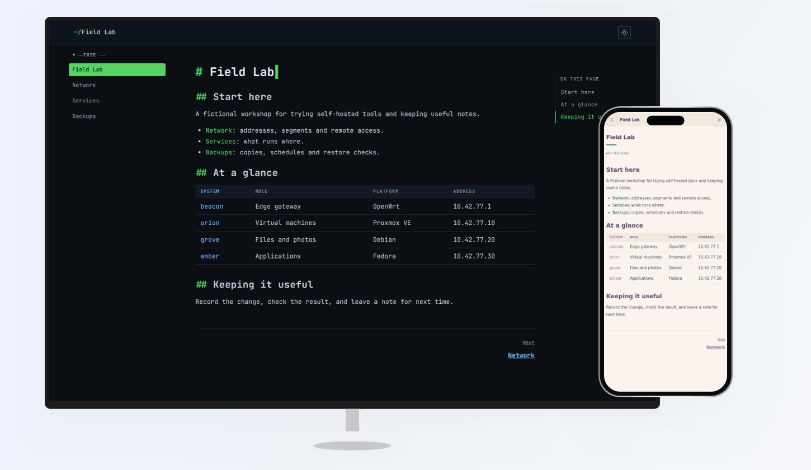

# Hold My Docs

**A wiki that gets on with it.**

Hold My Docs (HMD) runs as a single Go binary and keeps your content as Markdown in an ordinary Git repository. Every save is a commit, so your docs have real history and can sync to a remote you already use.



> [!WARNING]
> Hold My Docs is an early-stage project. Expect rough edges and breaking changes. Keep backups and test upgrades before relying on it as your only source for important documentation.


## Features

- Every save is a Git commit, and the wiki can push to and pull from a remote you configure.
- Read-only mode clones a public docs repository without a Git token, so you can browse it and pull updates.
- Namespaces give each area of the wiki its own visibility, navigation, appearance and page-creation defaults.
- The Markdown editor has a preview, wiki-links, backlinks, Mermaid diagrams, attachments, history and revert, and full-text search covers every page.
- With an operator-supplied Apache Tika Server, HMD also searches PDF and Office attachments locally, combining keyword and semantic search.
- People sign in with local accounts or OIDC single sign-on; access scopes and personal access tokens limit what each user or tool can do.
- An MCP server lets authorised agents read and write ordinary pages, with optional attachment search limited to chosen namespaces.
- Static export publishes a namespace as a site that runs without HMD.

## Quick start

### Docker Compose

```sh
export HMD_ADMIN_USER=admin
export HMD_ADMIN_PASSWORD='use-a-unique-password-of-at-least-12-characters'
docker compose up -d
curl -f http://127.0.0.1:8080/_/ready
```

Open <http://localhost:8080> and sign in with the bootstrap credentials. Remove the bootstrap environment variables after the first successful start.

The Compose file starts a local-only instance bound to loopback. To sync to a Git remote, create `./git_token.txt` and uncomment the `HMD_GIT_*` variables and the `git_token` secret. For document search, uncomment `HMD_DOCUMENT_SEARCH_TIKA_URL` and run with `docker compose --profile documents up`. Keep Tika private; see the docs site for hardening and sandboxing.

### Bare binary

```sh
go build -o hmd ./cmd/hmd
HMD_SERVER_BIND=:8080 \
HMD_SERVER_REPO_DIR=./data/repo \
HMD_APP_DIR=./data/app \
HMD_ADMIN_USER=admin HMD_ADMIN_PASSWORD='use-a-unique-password-of-at-least-12-characters' \
./hmd
```

Keep `HMD_APP_DIR` on local disk (not NFS); `HMD_SERVER_REPO_DIR` can be on network storage.

## Documentation

The [HMD docs site](https://hmd.sool.dev) covers installation, configuration, operations, MCP, and development.

## AI use

Parts of HMD are developed with AI coding assistants and several models. The maintainer reviews, corrects, and tests all changes and is responsible for the result.

## License

MIT. See [LICENSE](LICENSE).
